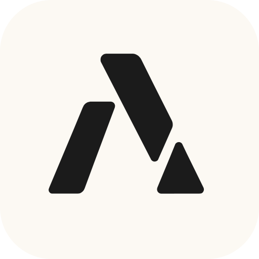

<p align="center">
  
</p>

# world-use

**Let AI agents operate robot arms.**

Camera observations, EdgeTAM tracking, measured geometry and bounded motion through **MCP, Python or the `wu` CLI**.
The agent chooses the targets and strategy; world-use executes each phase and returns feedback.

Start in MuJoCo. Early software, tested in simulation and on one Seeed reBot arm under supervision.

[Demos](#demos) · [Quickstart](#quickstart) · [Give it to an agent](#give-it-to-an-agent) · [Documentation](#documentation)

## Demos

Selected simulation runs. The kitchen examples were developed with scene knowledge and human feedback.

### Shape sorting

GPT-6.1 Sol sorts **4/4 pieces with world-use vs 3/4 raw**, with estimated episode costs of **$1.30 vs $2.02**.

https://github.com/user-attachments/assets/43a2caa8-aa29-41d6-84be-64477883f4d9

[Details](docs/shape-sorting.md)

### Lunchbox packing

An LLM-written program uses EdgeTAM, depth and measured alignment to pack two snacks compactly, then verifies each placement.

https://github.com/user-attachments/assets/f714e092-69e5-40ac-b7f6-bdeac1f4f6b9

[Details](examples/robocasa-lunchbox/README.md)

### Oven dial

The LLM selects the temperature dial. Measured landmarks guide the turn to **180°C** and the check after release.

https://github.com/user-attachments/assets/7dfb024d-f794-41f6-bd02-47260d103639

[Details](examples/robocasa-dial/README.md)

## How it works

Call tools interactively or write a Python task that uses fresh observations on each run.

| Step | What world-use provides |
| --- | --- |
| **Observe** | Camera frames and optional EdgeTAM masks for an agent-selected object. |
| **Measure** | Depth-based surface coordinates, plane projection and alignment from corresponding landmarks. |
| **Move** | Bounded plans, rehearsal against the estimated scene, a 100 Hz control loop and execution feedback. |
| **Verify** | Fresh observations to check the outcome, with plans, measurements and telemetry saved in a flight record. |

The agent owns grasps, scene estimates and success checks. Rehearsal depends on that scene estimate;
sensing depends on the adapter. The kitchen demos disable full-scene rehearsal and provide no joint torque sensing.
See [design](DESIGN.md) and [perception](docs/perception.md) for the contracts.

## Quickstart

Install from the current source with [uv](https://docs.astral.sh/uv/):

```sh
uv tool install --python 3.13 --with-executables-from rerun-sdk \
  "world-use[mcp,rerun] @ git+https://github.com/anyact-ai/world-use"
```

This installs Python 3.13, `wu` and the Rerun viewer as needed. Add `vision` for EdgeTAM or
`rebot` for the hardware driver.

Run a complete scripted task in simulation, without an LLM or robot:

```sh
wu demo
wu inspect runs/block-demo
wu view runs/block-demo
```

The demo verifies placement, releases torque and saves a record and animation. Later runs use numbered folders;
use the path printed by your run. Cameras need [OpenGL](docs/simulation.md#cameras-and-replay).
Try `wu demo --scenario missing` for a missed grasp and recovery. See the [block example](examples/pick-place)
to adapt the task.

## Give it to an agent

Start the simulation with `wu up --workcell block`, then give a shell-based agent this task:

```text
Run `wu policy` and follow it. A simulated robot arm is running. Move the orange
block to F=0.34, L=-0.07 in the work frame, standing on the tray. Verify placement,
then go home, switch torque off and report what you did and observed.
```

`wu policy` prints the [operating brief](src/world_use/POLICY.md). For MCP, keep the daemon running and
configure your client to launch `wu mcp`:

```json
{
  "mcpServers": {
    "world-use": {"command": "wu", "args": ["mcp"]}
  }
}
```

For EdgeTAM, include `vision` in the install extras and use `"args": ["mcp", "--vision"]`.
The [tracking guide](examples/tracking) covers model weights and device selection.

## Python

With the simulated daemon running and torque enabled, submit a phase:

```python
from world_use import Client, Plan

robot = Client()
phase = Plan("lift and open").line(up=0.06).gripper(aperture_mm=60)
result = robot.run(phase.spec(), wait=60)
print(result["status"])
```

Save as `task.py`. The tool install is isolated, so run it with:

```sh
uv run --with "world-use @ git+https://github.com/anyact-ai/world-use" python task.py
```

Return home and release torque afterward. See the [perception example](examples/perception) for a complete task,
or [task programs](examples/task-programs) to record code and inputs for repeated runs.

## Documentation

| Guide | Use it to |
| --- | --- |
| [Perception](docs/perception.md) | Measure camera pixels, align landmarks and require fresh evidence. |
| [Records and replay](docs/records.md) | Inspect a run, view it in Rerun or fit the robot model. |
| [Simulation](docs/simulation.md) | Configure MuJoCo scenes, cameras and rendering. |
| [RoboCasa setup](examples/robocasa-counter) | Build the shared Panda kitchen used by the packing and dial demos. |
| [Robot adapters](docs/adapters.md) | Connect another arm through a URDF, a description and a driver. |
| [reBot setup](docs/rebot.md) | Configure CAN, cameras and supervised hardware operation. |
| [Hardware records](docs/hardware.md) | Read what worked, what failed and what changed on the physical arm. |
| [Design](DESIGN.md) · [Changelog](CHANGELOG.md) | Understand the architecture and follow changes. |

## Contributing

Bug reports, examples and tested adapters are welcome. Include reproduction steps and relevant records,
with credentials and private images removed.

```sh
git clone https://github.com/anyact-ai/world-use.git
cd world-use
uv sync --locked
uv run pytest
uv run ruff check .
uv run ty check src
```

See [AGENTS.md](AGENTS.md) for conventions and [simulation](docs/simulation.md#cameras-and-replay) for test setup.

## License

Code: [Apache-2.0](LICENSE). The bundled Seeed reBot model is CERN-OHL-W-2.0; see its
[notice](src/world_use/bodies/rebot/NOTICE.md). The kitchen demos use upstream assets with
[separate attribution](examples/robocasa-counter/README.md#attribution).
