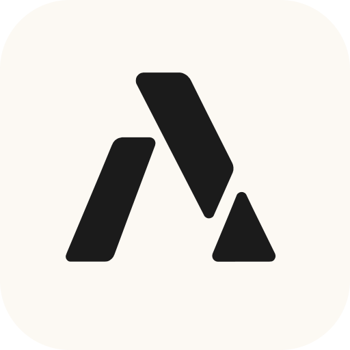
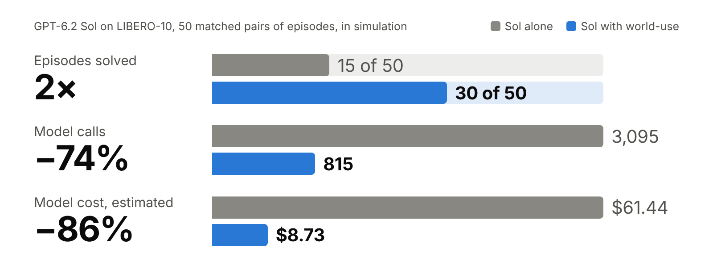

<p align="center">
  
</p>

# world-use

**Tools that let AI agents operate robot arms.**

The agent looks at camera images, picks out objects and decides what to do. world-use follows the objects
with EdgeTAM, measures where they are, checks each motion against the robot's limits, runs it in a 100 Hz
control loop and reports what happened. Use it over **MCP, from Python or with the `wu` CLI**.

Early software: tested in simulation and on one Seeed reBot arm under supervision. Start in MuJoCo; no robot needed.

[LIBERO-10](#libero-10) · [Demos](#demos) · [Quickstart](#quickstart) · [Give it to an agent](#give-it-to-an-agent) · [Documentation](#documentation)

## LIBERO-10

GPT-6.2 Sol as the policy of a simulated Franka Panda on the ten LIBERO-10 tasks solves **30 of 50 episodes
with world-use and 15 alone**, with 74% fewer model calls. Each pair of episodes starts from the same state,
with the same simulator, step limit and success check; 30 of the pairs are on initial states that were run
once, after the tools were finished.

<picture>
  <source media="(prefers-color-scheme: dark)" srcset="https://raw.githubusercontent.com/anyact-ai/world-use/main/docs/assets/libero-results-dark.png">
  
</picture>

Alone, the model sends the hand to poses it picks from camera images. With world-use it can also mark
objects for EdgeTAM to follow, locate them from the wrist camera without depth, and call grasp, place and
push tools that report position error, contact and finger opening. No episode of either arm got the mug into
the microwave, and 11 of world-use's 20 failures were a `done` the success check rejected.
[Setup, per-task results, limits and how to reproduce](examples/libero/README.md)

## Demos

Selected simulation runs. The kitchen demos were developed with scene knowledge and human feedback.

### Shape sorting

GPT-6.1 Sol sorts **4/4 pieces with world-use vs 3/4 raw**, with estimated episode costs of **$1.30 vs $2.02**.

https://github.com/user-attachments/assets/43a2caa8-aa29-41d6-84be-64477883f4d9

[Details](docs/shape-sorting.md)

### Lunchbox packing

An LLM-written program uses EdgeTAM, depth and measured alignment to pack two snacks compactly, then verifies each placement.

https://github.com/user-attachments/assets/f714e092-69e5-40ac-b7f6-bdeac1f4f6b9

[Details](examples/robocasa-lunchbox/README.md)

### Oven dial

The LLM selects the temperature dial. Measured landmarks guide the turn to **180°C** and the check after release.

https://github.com/user-attachments/assets/7dfb024d-f794-41f6-bd02-47260d103639

[Details](examples/robocasa-dial/README.md)

## How it works

An agent calls tools one at a time, or writes a Python task that takes fresh observations on each run.

| Step | What world-use provides |
| --- | --- |
| **Observe** | Camera frames, and EdgeTAM masks of objects the agent marks with a point or a box. |
| **Measure** | Positions in metres from depth, or from two looks with a camera on the hand; plane fits and alignment from matching landmarks. |
| **Move** | Plans checked against the robot's limits, optionally rehearsed in a MuJoCo copy of the scene, run by a 100 Hz control loop that reports arrival, contact and grip. |
| **Verify** | New pictures to check the result, and a flight record of plans, measurements and telemetry. |

The agent decides what to grasp, where things are and whether the task succeeded. Rehearsal only knows the
objects the agent has described, and what is sensed depends on the robot's driver: the kitchen demos run
without rehearsal and without joint torque sensing. [Design](DESIGN.md) and [perception](docs/perception.md)
have the details.

## Quickstart

Install with [uv](https://docs.astral.sh/uv/):

```sh
uv tool install --python 3.13 --with-executables-from rerun-sdk "world-use[mcp,rerun]"
```

This installs `wu`, the Rerun viewer and Python 3.13 if needed. Add `vision` to the extras for EdgeTAM or
`rebot` for the reBot driver.

Run a complete scripted task in simulation, without an LLM or robot:

```sh
wu demo
wu inspect runs/block-demo
wu view runs/block-demo
```

A script moves a block 10 cm along a tray, checks in the simulator that it stands where it should,
switches torque off and saves a record and an animation.
Later runs go to numbered folders; use the path your run prints. Cameras need
[OpenGL](docs/simulation.md#cameras-and-replay). `wu demo --scenario missing` shows a missed grasp and the
recovery. The [block example](examples/pick-place) shows how to adapt the task.

## Give it to an agent

Start the simulation with `wu up --workcell block`, then give a shell-based agent this task:

```text
Run `wu policy` and follow it. A simulated robot arm is running. Move the orange
block to F=0.34, L=-0.07 in the work frame, standing on the tray. Verify placement,
then go home, switch torque off and report what you did and observed.
```

`wu policy` prints the [operating brief](src/world_use/POLICY.md). For MCP, keep the daemon running and
configure your client to launch `wu mcp`:

```json
{
  "mcpServers": {
    "world-use": {"command": "wu", "args": ["mcp"]}
  }
}
```

For EdgeTAM, include `vision` in the install extras and use `"args": ["mcp", "--vision"]`.
The [tracking guide](examples/tracking) covers model weights and device selection.

## Python

With the simulated daemon running and torque enabled, submit a phase:

```python
from world_use import Client, Plan

robot = Client()
phase = Plan("lift and open").line(up=0.06).gripper(aperture_mm=60)
result = robot.run(phase.spec(), wait=60)
print(result["status"])
```

Save it as `task.py`. The tool install is isolated from your projects, so run it with:

```sh
uv run --with world-use python task.py
```

Go home and switch torque off afterwards. The [perception example](examples/perception) is a complete task;
[task programs](examples/task-programs) record code and inputs for repeated runs.

## Documentation

| Guide | Use it to |
| --- | --- |
| [LIBERO-10](examples/libero) | Reproduce the benchmark comparison or run another model on it. |
| [Perception](docs/perception.md) | Measure from camera pixels, locate objects with a wrist camera and align landmarks. |
| [Tracking](examples/tracking) | Download EdgeTAM and choose the device it runs on. |
| [Records and replay](docs/records.md) | Inspect runs, references and named evaluations together in Rerun. |
| [Simulation](docs/simulation.md) | Configure scenes, validate references and run comparable evaluations. |
| [RoboCasa setup](examples/robocasa-counter) | Build the shared Panda kitchen used by the packing and dial demos. |
| [Letter pushing](examples/push-letters) | Run a camera-feedback pushing policy, change starts or friction, and audit the physics. |
| [Robot adapters](docs/adapters.md) | Connect another arm through a URDF, a description and a driver. |
| [reBot setup](docs/rebot.md) | Configure CAN, cameras and supervised hardware operation. |
| [Hardware records](docs/hardware.md) | Read what worked, what failed and what changed on the physical arm. |
| [Design](DESIGN.md) · [Changelog](CHANGELOG.md) | Understand the architecture and follow changes. |

## Contributing

Bug reports, examples and tested adapters are welcome. Include steps to reproduce and the relevant flight
records, with credentials and private images removed.

```sh
git clone https://github.com/anyact-ai/world-use.git
cd world-use
uv sync --locked
uv run pytest
uv run ruff check .
uv run ty check src
```

See [AGENTS.md](AGENTS.md) for conventions and [simulation](docs/simulation.md#cameras-and-replay) for test setup.

## License

Code: [Apache-2.0](LICENSE). The bundled Seeed reBot model is CERN-OHL-W-2.0; see its
[notice](src/world_use/bodies/rebot/NOTICE.md). The kitchen demos use upstream assets with
[separate attribution](examples/robocasa-counter/README.md#attribution).
