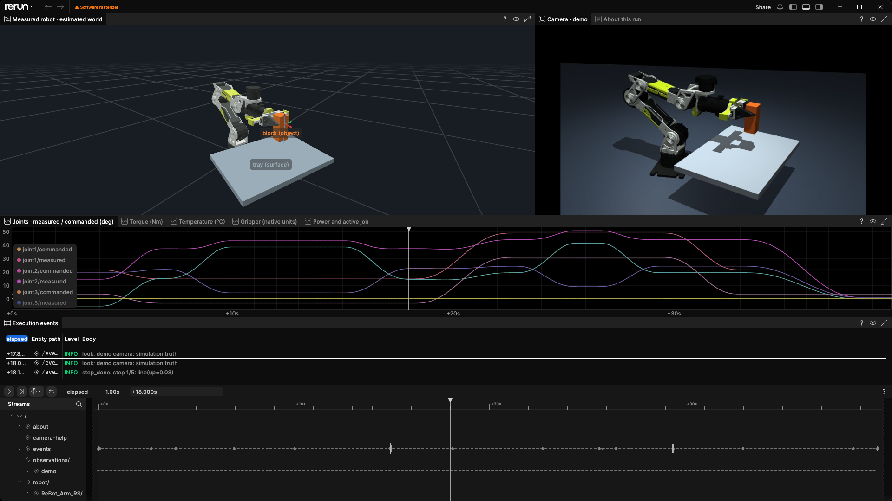

# Flight records

Every `wu up` session, `wu demo` and the perception example write a flight record: one folder under `./runs` (or
`$WORLD_USE_RUNS`) with the plans, outcomes, telemetry and pictures, and the robot model they ran on. The commands
below read records offline. None of them opens a robot driver or runs a plan again.

```sh
wu inspect runs/block-demo                            # a summary; --json for everything
wu replay runs/block-demo --out replay.gif --speed 3  # a GIF of the recorded joints and world model
wu view runs/block-demo                               # the record in Rerun
wu view runs/block-demo --out block-demo.rrd          # the same, saved to a file
wu fit runs/RUN-1 runs/RUN-2                          # link masses and joint friction, from recorded runs
```

`wu inspect` prints the robot, the mode, whether the record closed normally, the powered and moving time, and each
job's outcome. `powered` counts from each attempt to switch torque on to a confirmed switch-off, ramps and
unconfirmed intervals included. `moving` is the time spent in motion steps, not independently detected movement.
Both are elapsed time on one monotonic clock that events and telemetry share. A record closed normally when its
`complete.json` matches the saved chunk and event counts; a `closed` event alone only means the robot connection
closed, and the final write may still have failed. An open or interrupted record reports only the telemetry
already saved.

`wu replay` renders the measured joints and the recorded world model with the saved robot geometry, and labels the
frames as a reconstruction. The original camera pictures stay in `views/`. `wu fit` writes `fit.json`; the
[2026-09-28 hardware record](hardware.md#2026-09-28-a-model-fitted-from-flight-records) shows what a fit changes.

[External simulation sessions](simulation.md#external-simulation-sessions) also save the compiled scene, full
physics states and exact policy observations beside `flight/`. For these records, `wu replay` follows
`flight/external-scene.json` to restore the actual scene through a fixed recorded camera, without stepping physics.
Keep the whole episode folder together. Rerun's 3D view still shows the estimated world.

## Inspect an experiment

`wu inspect` and `wu view` also accept an external episode, an evaluation suite or
trial, or a scene-validation directory. Select a named case to connect the suite's
revision and outcome to its flight record and exact policy observations:

```sh
wu inspect runs/evaluation --case nominal-seed17 --json
wu view runs/evaluation --case nominal-seed17
wu view runs/evaluation --case nominal-seed17 --scene --out case.rrd
wu view runs/scene-validation/refined --out comparison.rrd
wu rerun runs/evaluation nominal-seed17 --out runs/evaluation-repeat
```

Inspection also accepts a recorded Python task directory. `task_trace.phases` lists
named phases with their IDs, parents and completion state. Expand one with
`wu inspect runs/evaluation --case nominal-seed17 --phase 42 --json`, using an ID
from that list. The result includes nested phases, recorded calls, checked artifact
references and known job outcomes; large frames and arrays stay in their files.
A phase without an end, or a call without a reply, shows an unknown outcome:
inspection does not guess whether motion stopped or succeeded. Phase times count
from the task start, and job IDs link the trace to the flight record, whose clock
starts with the kernel.

The viewer labels reference comparisons, raw policy frames and estimated geometry
separately. `--scene` adds a snapshot rendered from the recorded simulation state,
with the same graphics needs as replay. It never advances physics, and it is not a
new observation or a physical validation; `wu replay` shows the full motion.
Raw frames use the `policy_elapsed` timeline, counted from the task start; flight
telemetry uses `elapsed`, counted from the kernel start. The two are not aligned:
choose the one you need.

Inspection is read-only. `wu rerun` runs the recorded, trusted Python policy and
evaluator again, in fresh processes and a fresh output directory, and refuses if the
source, inputs or runtime changed. It can recreate failed and interrupted cases; a rerun
that completes can still fail its task check.

For embedded scene development, [`SimulationWorkspace`](../src/world_use/inspection.py)
takes a `factory(fresh_output) -> SimulationSession`. `reset()` builds a new
episode under the same declared scene revision; `reload(factory,
scene_revision=...)` tries a revised scene. Both require the current simulation
to be idle with power confirmed off. A failed candidate keeps the last valid
record and writes the error to `inspection.json`, the pointer that
`wu view WORKSPACE --follow` follows in one viewer. Reset and reload are Python
calls only: the viewer edits no scene source and controls no hardware. The scene
owner must not make other control calls while resetting or reloading. If storage
fails while the replacement is published, the candidate is closed and the previous
recorded scene stays selected, although its daemon may already be closed.

## View in Rerun



`wu view` needs the `rerun` extra. The README's install line exposes both `wu` and `rerun`; `wu view` also finds the
viewer inside its tool environment. Rerun runs in its own process and reads the record; closing it never stops a
job or changes motor power.

The window has a 3D view of the robot's own geometry, a camera pane, measured and commanded joint plots, torque,
temperature, gripper, power and the active job, and the events, all on the run's `elapsed` timeline. Drag the
timeline to inspect a grasp, a refusal or a recovery. Joint plots keep every committed sample; the world and the
last ten seconds of tool path update at up to 20 Hz.

The 3D scene shows measured joints and the estimated world: a carried box is what the runtime believed it held,
not recovered physical motion. Camera pictures show the captured scene, with any overlays `wu look` drew. A
[measurement](perception.md) adds its picture to its camera's pane at the time the picture was taken, and its
surface points to the 3D scene, in green, from the time it was measured.

The viewer moves the arm joints and a calibrated gripper with two prismatic fingers. Other gripper joints stay where
the URDF puts them, with a warning in the event pane.

## Follow a live run

```sh
wu up --workcell block
wu view
```

With no folder, `wu view` follows the local daemon's record, including edits made through `wu box` or other
world tools, usually one to two seconds behind control. It stays connected across completed sessions,
waits through daemon restarts and opens the next session as a separate named recording. Ctrl+C stops
following; the Rerun window stays open. The daemon must be running when you first start `wu view`.

Supplying a folder opens that saved recording. Add `--follow` to follow it until completion; it does not
switch to other runs. A portable export with `--out` also stays with one recording. Camera pictures arrive
when a client calls `wu look` or measures; nothing streams video. Scene-file edits take effect when loaded
by a new daemon, not merely when saved. The folder must be readable where the viewer runs: for a remote
daemon, copy or mount its record.

## Headless export

```sh
wu view runs/block-demo --out block-demo.rrd
rerun block-demo.rrd
```

Export needs no display, daemon or robot driver. The `.rrd` file holds the meshes, measurements, pictures, events
and layout; open it on any machine with Rerun 0.38. `--follow --out session.rrd` exports a growing run until it
completes or Ctrl+C. The interactive viewer needs a graphics backend: on a cloud host, export and open the file
locally. Simulated cameras have their own rendering needs; see [simulation](simulation.md).

## What a record holds

| file | contents |
| --- | --- |
| `session.json` | package version, source and URDF hashes, the body and its mode, the daemon's startup identity and workcell, and the initial snapshot: robot description, world, commanded and measured state, fitted model |
| `robot.urdf` | the geometry used by this run; its limits and gripper description are in `session.json` |
| `assets/`, `robot-assets.json` | a custom robot's meshes and their original paths; for a built-in robot, its license notices only |
| `events.jsonl` | submitted plans, outcomes, checkpoint questions and answers, contacts, world changes, picture paths, notes |
| `tape/000000.npz`, ... | telemetry and power transitions in chunks; together the complete history |
| `summary.json`, `world.json` | the summary and world model at the last explicit save or normal close |
| `complete.json` | the final chunk and event counts, written only when the record closed cleanly |
| `recording.json` | how many samples, events and power transitions were lost, only if a buffer overran |
| `views/` | saved camera pictures |
| `perception/<id>.png`, `.npz` | one pair per measurement: the picture with the measured pixels drawn on it, and the measured `points` (base frame, metres) with the `pixels` they came from |

A record stays usable after the run folder moves or the robot's driver is uninstalled. A built-in robot's meshes
ship with world-use, and a record finds them when its URDF matches the installed one exactly.

Records written by world-use 0.2.0 hold their telemetry in one `tape.npz` and have no `session.json`: `wu inspect`
and `wu fit` read them; replay and the viewer cannot. In Python, `world_use.recorder.load_tape(run_folder)` returns
the complete arrays of either kind.

## How it is written

A background thread saves events and telemetry once per second, off the control loop. A killed process loses at
most the current second and an unfinished event line; earlier chunks stay readable. Storage failures never fault the
robot or block release and shutdown; `wu status --json` reports them.

The daemon keeps telemetry it has not yet saved in a bounded buffer: 30,000 samples (five minutes at 100 Hz), 5,000
power transitions and the latest 5,000 events. If storage stays down long enough to fill it, the oldest entries are
dropped, status reports the loss at once, `recording.json` keeps the counts, and `wu inspect` and Rerun flag the
record as incomplete. Gaps show in the sample indices and event numbers, and durations do not count across them.

Summaries add up durations and extremes as the run goes. Beyond 8,192 powered ticks, the summary's tick median
and p99 come from a uniform sample of that size (`tick_percentile_sample`); the maximum is exact, and `wu inspect`
computes exact percentiles from the saved chunks.

## What an agent adds

Named simulation evaluations keep `suite.json` with the frozen setup, policy and evaluator source,
declared input hashes, runtime identity, scene revision and every case and seed. Each
`trials/<name>/trial.json` records execution status, outcome, reasons, interventions,
wall and simulation time, recording integrity and power cleanup. Setup, policy and
privileged evaluator artifacts stay in separate directories beside `scene/` and `episode/`.
The status follows from what was recorded: an interrupt, or a policy process lost
without a final record, is `interrupted`; a failed setup or evaluator, changed inputs,
sources or runtime, or an incomplete recording or evaluator result is `invalid`;
anything else is `completed`.
A case that never wrote `trial.json` stays in the summary as an interrupted attempt.

A matching `scene-validation.json` and its hashed files can accompany the
suite. The report's artifact manifest lists the raw stability samples, reference
inputs, comparison details and images; every listed file is verified and copied
for both evaluations and reruns. Regenerate a report that has no artifact manifest
before attaching it to a suite. Camera and appearance, geometry and physical-response
results stay separate from task success. A missing reference is `unvalidated`; a
stale scene revision is rejected. See
[reference checks and repeated evaluation](simulation.md#reference-checks-and-repeated-evaluation).

For saved Python tasks, the [task-program example](../examples/task-programs) records source snapshots,
parameters, full frames and computations beside the flight record. Each run of the program takes fresh
observations; analysing a record or replaying its motion never runs the robot again.

```python
robot.record(context={"model": "your-model", "prompt": "move the block", "role": "live policy"})
robot.record(note="Operator moved an obstacle before answering the checkpoint")
```

From the shell: `wu record --context inputs.json --note '...'`; MCP's `record` takes the same fields. They are
saved as given, so keep credentials out of them. A `done` outcome means the commands completed; the block example
saves its separate success check in `result.json` and a `task_result` event.

CLI and MCP job replies include the final step's measured facts, such as a settling
`reason` or a grip check's drift. For a successful sequence, MCP sends
`Outcome.feedback()`, which replaces the list of step messages with `last_step`, the
final step's own feedback; embedded callers can use it too. HTTP job replies and
`Outcome.to_dict()` keep the full final-step result and the step messages, and every
completed step of a sequence writes its full outcome to a `step_done` event, so the
record keeps what shorter replies leave out. Failures keep their `expected`,
`observed` and `hint`.

Each measurement adds a `measurement` event with what the agent received: its id, camera and frame, `valid` and
`reason`, `surface_center`, `visible_bounds` and `from_tool` in the work frame, the picture's capture time
(`capture_t`) and the path of its picture. Its two files are written before the agent gets the reply, so a storage
failure fails the measurement instead of losing it later. A `withdrawn` event lists measurements a tracker withdrew
after losing their target.
