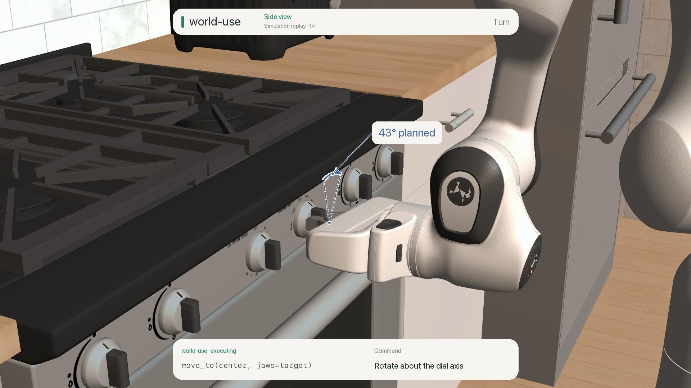

# Oven dial

A Franka Panda must set the oven to **180°C**, choosing among six controls with
burner symbols, timer markings and a Fahrenheit temperature scale.

[](../../docs/assets/kitchen-dial.mp4)

## What world-use adds

- **Pixels to measured geometry.** `camera_frame` returns calibrated side and
  wrist RGB-D. The LLM selects the control; `select_target` runs EdgeTAM and
  `measure_pixels` supplies points on the handle, panel and scale marks.
- **Geometry to motion.** Task Python estimates the dial axis from the panel
  and calculates the turn between measured marks. World-use executes the
  requested approach, grip, rotation and withdrawal, with gripper feedback.
- **Evidence after release.** A fresh wrist frame and new landmark measurements
  let the agent compare the released pointer with the requested temperature.

The LLM reads the labels and converts 180°C to 356°F; task Python calculates the
angle. World-use supplies geometry and execution, without a built-in oven policy.
Codex chose the MCP calls interactively during development, with scene knowledge.

## Result and scope

The agent planned a **42.7° turn**. After release, the measured pointer read
**about 360°F** against the **356°F target**, within the trial's ±5°F tolerance.
The contact audit found no unintended robot contacts in 8,931 saved states.
One untouched burner knob drifted 0.74° passively; the other non-target controls
changed less than 0.001°.

Finger contact drives the dial. The agent assumes its axis is normal to the
panel; it does not read the simulator's hinge position. This selected trial uses
approximate knob friction and idealized cameras, with no heat, detents or
push-to-turn interlocks. Joint torque sensing and full-scene rehearsal are
unavailable (`rehearse=False`). It is a development example, not a hardware or
repeatability result.

The 40-second video keeps identification on a static side-camera input, then
shows the saved wrist input and fresh verification. Motion plays at 1× from a
labeled presentation view; decision gaps are cut. Overlays illustrate recorded
measurements and calculations, including the planned rotation.

## Run locally

Complete the [upstream kitchen setup](../robocasa-counter/README.md#build-the-upstream-scene),
then use world-use's Python 3.13 environment with vision extras:

```sh
.venv/bin/python examples/robocasa-dial/prepare.py
.venv/bin/python -i examples/robocasa-dial/episode.py --output runs/dial-new
```

This starts an interactive recorder, not an automatic task. Read `wu policy`,
inspect observations and choose calls with `act`; save decisions with `note` and
end with `finish` after releasing the robot. Use a new output directory each time.

The audit and renderer select calls from the retained trial 03; adapt their call
indices for a new episode:

```sh
.venv/bin/python examples/robocasa-dial/audit_episode.py runs/dial-agent-03
.venv/bin/python examples/robocasa-dial/render_episode.py runs/dial-agent-03
```

Native MuJoCo graphics are required; rendering also uses Pillow, ffmpeg and macOS
SF fonts. `runs/dial-agent-03/` retains calls, decisions, raw RGB-D, calibration,
replay and audit. Earlier failed trials remain in `dial-agent-01` and
`dial-agent-02`. Raw recordings and downloaded assets are not bundled. See the
[asset attribution](../robocasa-counter/README.md#attribution).
