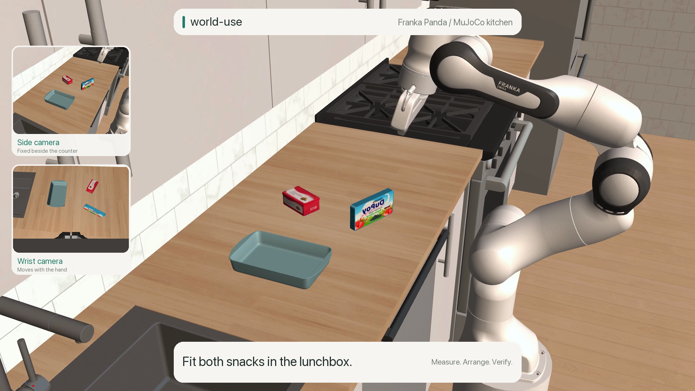

# Lunchbox packing

An LLM-written Python program packs two snacks into a small open container using
fresh world-use measurements. The program runs without model calls during execution.

[](../../docs/assets/kitchen-tool-use.mp4)

## What world-use adds

- **Geometry from images.** `select_target` uses EdgeTAM and depth to return
  package and container surfaces. `measure_pixels` supplies floor and counter
  heights. The task code uses these measurements to calculate compact placement
  coordinates and release heights.
- **Grasp-aware alignment.** `align_planar` converts corresponding measured
  footprints into a tool position and yaw, accounting for an off-center grasp.
  Its result drives the carry command; the task calculates vertical placement
  from the measured support heights.
- **Checks around motion.** `requires` ties moves to evidence-age limits.
  Gripper feedback and fresh `observe_targets` measurements check pickup and
  retention; new RGB-D measurements check position, height and containment after
  release.

The [task program](task.py) owns the image regions, packing order, layout and
clearances. World-use supplies measurements, alignment and execution. Policy
inputs are RGB-D and robot feedback; simulator poses are reserved for the audit.

## Result and scope

Both packages were released inside the container, with a measured 12.8 mm gap
and no unintended contacts in the sampled replay. The **same program** also
passed a shifted, rotated layout: new measurements changed its destinations and
the cookie-box rotation from about 24° to 40°.

These are two development checks with scene knowledge and human feedback. The
scene uses rigid packages, an open container scaled to 1.10×, a cookie box scaled
to 0.85× and idealized RGB-D. Alignment assumes a rigid grasp; center checks can
miss rotation. The adapter has no joint torque sensing or full-scene collision
rehearsal (`rehearse=False`). Contact physics drives the objects; post-run audits
check support and stability separately from camera checks.

The 63-second video uses saved side/wrist observations and recorded motion at 2×,
with pauses cut. The opening uses a presentation camera; overlays show measured
geometry and the task's calculations.

## Run locally

Complete the [upstream kitchen setup](../robocasa-counter/README.md#build-the-upstream-scene),
then use world-use's Python 3.13 environment with vision extras:

```sh
.venv/bin/python examples/robocasa-lunchbox/prepare.py
.venv/bin/python examples/robocasa-lunchbox/task.py --output runs/lunchbox-new
.venv/bin/python examples/robocasa-lunchbox/audit_episode.py runs/lunchbox-new
.venv/bin/python examples/robocasa-lunchbox/render_episode.py runs/lunchbox-new
```

Use a new output directory for each run. `--measure-only` checks perception and
layout without powering the simulated robot. EdgeTAM downloads weights on first
use. Native MuJoCo graphics are required; rendering also uses Pillow, ffmpeg and
macOS SF fonts.

<details>
<summary>Run the shifted-layout check</summary>

```sh
.venv/bin/python examples/robocasa-lunchbox/prepare.py \
  --output runs/robocasa-lunchbox-shifted/scene --variant shifted
.venv/bin/python examples/robocasa-lunchbox/task.py \
  --scene runs/robocasa-lunchbox-shifted/scene --output runs/lunchbox-shifted-new
.venv/bin/python examples/robocasa-lunchbox/audit_episode.py runs/lunchbox-shifted-new
```

</details>

Selected records: `runs/lunchbox-compact-05/` and
`runs/lunchbox-compact-shifted-03/`. They retain task source, measurements, calls,
replays and audits; failed trials remain separate. Raw records and downloaded
assets are not bundled. See the [asset attribution](../robocasa-counter/README.md#attribution).
